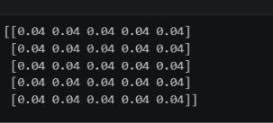
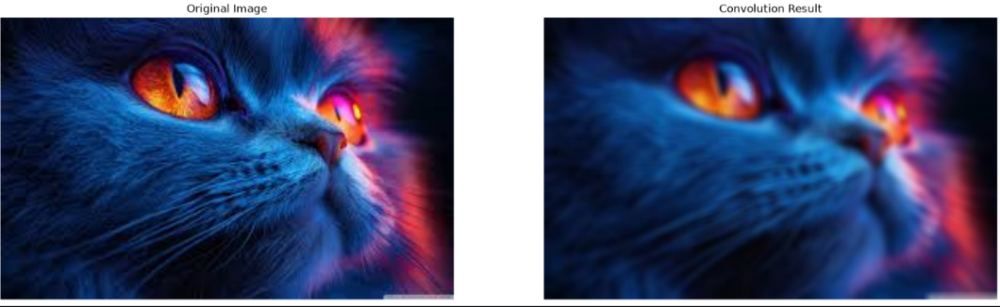
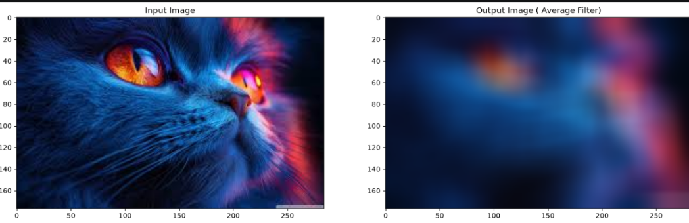
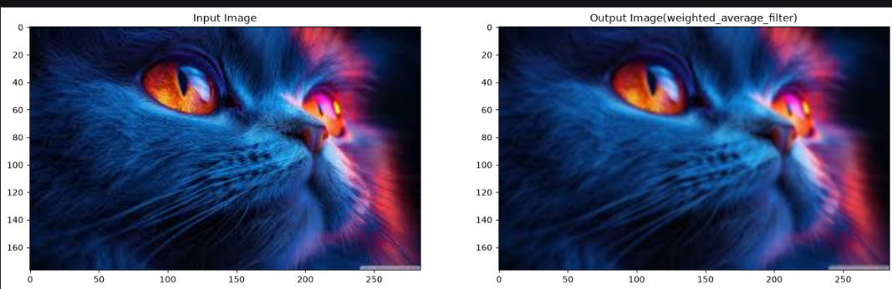
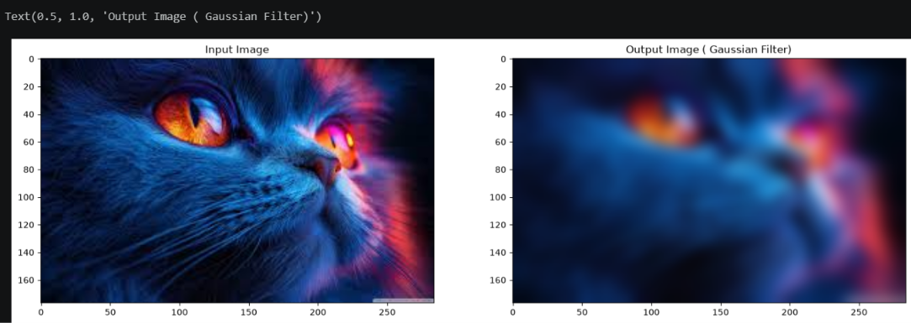
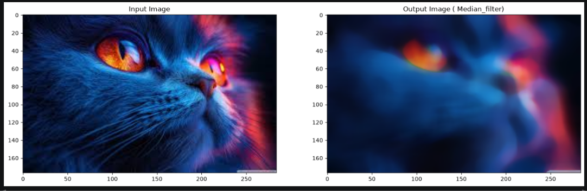
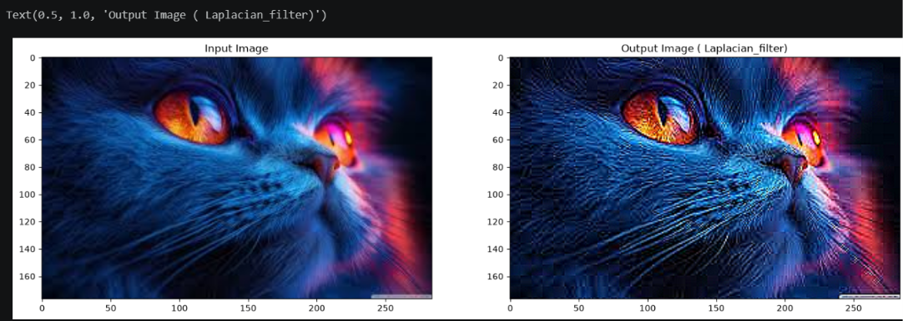
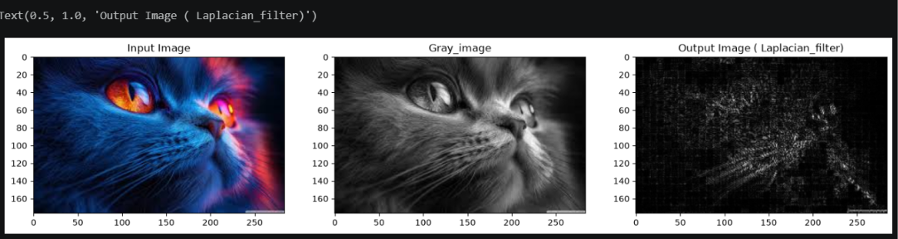

# EX5
# Image Smoothing and Sharpening Using OpenCV
## NAME:NARENDRA KRISHNAN KS
## REG NO: 212225240096
## Aim

To write a Python program using OpenCV to apply different smoothing filters (Averaging, Weighted Averaging, Gaussian, Median) and sharpening filters (Laplacian Kernel and Laplacian Operator) for image enhancement, and display each result separately along with the original image for comparison.

---

## The program performs the following operations:

- Read and display an input image  
- Apply Averaging filter  
- Apply Weighted Averaging filter  
- Apply Gaussian filter  
- Apply Median filter  
- Apply Laplacian sharpening using kernel  
- Apply Laplacian operator  
- Display all outputs for comparison  

---

##  Software Used

- Anaconda – Python 3.7  
- Jupyter Notebook / VS Code  
- OpenCV (cv2)  
- NumPy  
- Matplotlib  

---

##  Algorithm

### Step 1:
Import the required libraries: OpenCV, NumPy, and Matplotlib.

### Step 2:
Read the input image (e.g., `image.jpg`).

### Step 3:
Convert the image from BGR to RGB format for display.

### Step 4:
Apply Averaging Filter using `cv2.blur()`.

### Step 5:
Apply Weighted Averaging Filter using a custom kernel with `cv2.filter2D()`.

### Step 6:
Apply Gaussian Filter using `cv2.GaussianBlur()`.

### Step 7:
Apply Median Filter using `cv2.medianBlur()`.

### Step 8:
Apply Laplacian Sharpening using Kernel with `cv2.filter2D()`.

### Step 9:
Convert image to grayscale and apply Laplacian Operator using `cv2.Laplacian()`.

### Step 10:
Display all filtered images using a grid layout for comparison.

---
## PYHTON PROGRAM:
## PROGRAM FOR IMPORTING THE LIBRARIES AND READING THE FILE:
~~~
import cv2
import numpy as np
import matplotlib.pyplot as plt
---
# Read the input image
image = cv2.imread('cat.jpg')
image = cv2.cvtColor(image, cv2.COLOR_BGR2RGB) 
~~~
## Define a Kernel
## PROGRAM
~~~

kernel = np.ones((5,5), dtype = np.float32) / 5**2

print (kernel)
~~~
## OUTPUT:

## To Perform Convolution 

## PROGRAM:
~~~
image = cv2.imread('cat.jpg')

dst = cv2.filter2D(image, ddepth = -1, kernel = kernel)

plt.figure(figsize = [20,10])
plt.subplot(121); plt.axis('off'); plt.imshow(image[:,:,::-1]); plt.title("Original Image")
plt.subplot(122); plt.axis('off'); plt.imshow(dst[:,:,::-1]);   plt.title("Convolution Result");
~~~
## OUTPUT:

## 1. Smoothing Filter

### Method: Convolving the image with a 5 x 5 kernel

##  Using Averaging Filter
## PROGRAM:
~~~
average_filter = cv2.blur(image, (30,30))
---
# Display the images.

plt.figure(figsize = (18, 6))
plt.subplot(121); plt.imshow(image [:, :, ::-1]); plt.title('Input Image')
plt.subplot(122); plt.imshow(average_filter[:, :, ::-1]); plt.title('Output Image ( Average Filter)')
~~~
## OUTPUT:

##  Using Weighted Averaging Filter (custom kernel)

### . The middle pixel gets the maximum weight while the pixels farther away are given less weight.
### . The Gaussian filter follows a specific mathematical distribution (the Gaussian function), while the weighted averaging filter can use arbitrary weights.
## PROGRAM:
~~~
kernel = np.array([[1,2,1],[2,4,2],[1,2,1]])/16
weighted_average_filter = cv2.filter2D(image, -1, kernel)
----
# Display the images.
plt.figure(figsize = (18, 6))
plt.subplot(121);plt.subplot(121); plt.imshow(image [:, :, ::-1]); plt.title('Input Image')
plt.subplot(122);plt.imshow(weighted_average_filter[:, :, ::-1]); plt.title('Output Image(weighted_average_filter)');plt.show()
~~~
## OUTPUT:

## PROGRAM:
~~~
# Apply Gaussian blur.
gaussian_filter = cv2.GaussianBlur(image, (29,29), 0, 0)
---
# Display the images.

plt.figure(figsize = (18, 6))
plt.subplot(121); plt.imshow(image [:, :, ::-1]); plt.title('Input Image')
plt.subplot(122); plt.imshow(gaussian_filter[:, :, ::-1]); plt.title('Output Image ( Gaussian Filter)')
~~~
## OUTPUT:

## Using Median Filter

## PROGRAM:
~~~
median_filter = cv2.medianBlur(image, 19)
~~~
## . median filter is often used for removing salt-and-pepper noise (random black-and-white pixels) in an image. It is effective at preserving edges while smoothing out the noise
## PROGRAM:
~~~
# Display the images.

plt.figure(figsize = (18, 6))
plt.subplot(121); plt.imshow(image [:, :, ::-1]); plt.title('Input Image')
plt.subplot(122); plt.imshow(median_filter[:, :, ::-1]); plt.title('Output Image ( Median_filter)')
~~~
## OUTPUT:

## Sharpening Filters

### Using . Laplacian .Kernel .(Manual .Kernel)
## PROGRAM:
~~~
laplacian_kernel = np.array([[0, -1, 0],
                             [-1, 5, -1],
                             [0, -1, 0]])
sharpened_laplacian_kernel = cv2.filter2D(image, -1, kernel = laplacian_kernel)
~~~
## PROGRAM:
~~~
# Display the images.

plt.figure(figsize = (18, 6))
plt.subplot(121); plt.imshow(image [:, :, ::-1]); plt.title('Input Image')
plt.subplot(122); plt.imshow(sharpened_laplacian_kernel[:, :, ::-1]); plt.title('Output Image ( Laplacian_filter)')
~~~
## OUTPUT:

## Using Laplacian Operator (OpenCV built-in)

## PROGRAM:
~~~
gray_image = cv2.cvtColor(image, cv2.COLOR_RGB2GRAY)
laplacian_operator = cv2.Laplacian(gray_image, cv2.CV_64F)
laplacian_operator = np.uint8(np.absolute(laplacian_operator))
---
# Display the images.

plt.figure(figsize = (18, 6))
plt.subplot(131); plt.imshow(image [:, :, ::-1]); plt.title('Input Image')
plt.subplot(132); plt.imshow(gray_image, cmap='gray'); plt.title('Gray_image')
plt.subplot(133); plt.imshow(laplacian_operator,cmap='gray'); plt.title('Output Image ( Laplacian_filter)')
~~~
## OUTPUT:

##  Output

### Smoothing Filters

- Averaging filter produces blurred image  
- Weighted averaging provides smoother result with less distortion  
- Gaussian filter preserves edges better while reducing noise  
- Median filter removes salt-and-pepper noise effectively  

###  Sharpening Filters

- Laplacian kernel enhances edges and fine details  
- Laplacian operator detects edges clearly in grayscale  

---

##  Result

Thus, smoothing filters and sharpening filters are successfully implemented using OpenCV.

The smoothing filters reduce noise and improve image quality, while sharpening filters enhance edges and details for better feature extraction.
